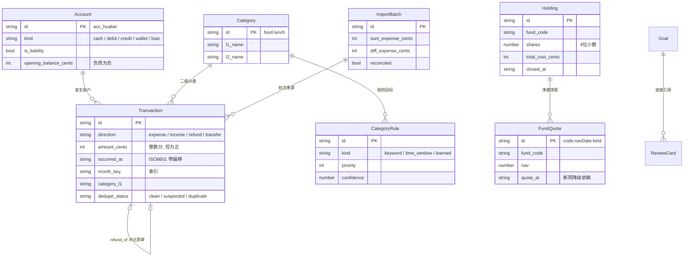
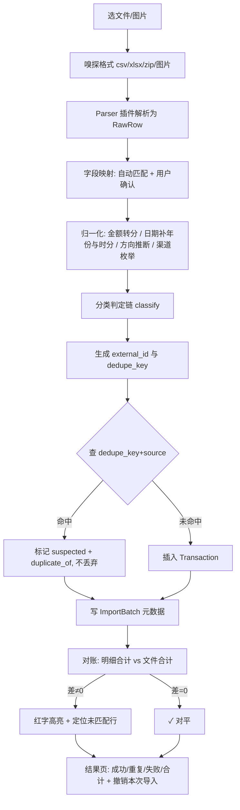
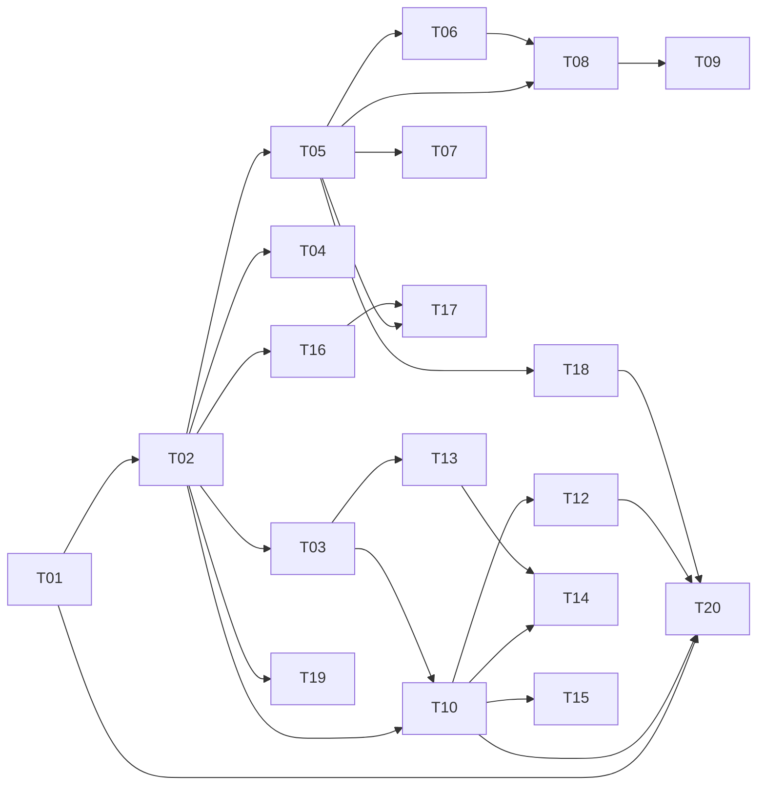

# 架构设计 · money_time_ledger
| 项 | 内容 |
|---|---|
| 文档 / 版本 | `02-arch.md` / v1.0 ｜ 作者：架构师 高见远 ｜ 上游：`01-prd.md`（PM 许清楚） |
| 形态 | 纯前端 SPA + PWA，静态托管，**无后端、无账号**；数据仅存本机 IndexedDB（Dexie） |

## 0. 结论摘要
- **技术栈**：Vite 5 + React 18 + TypeScript + MUI 5 + Tailwind 3 + Dexie 4 + Zustand + Recharts。
- **无后端是架构决策**：静态托管只有 GET，**没有可写入的端点**，R1「交易数据不上传」由部署形态物理保证，抓包即可验收（§1.4）。
- **汇总只计算不存储**：数据层不存在"月小计"实体；唯一落库的月度物化数据是复盘快照 `ReviewCard`（理由 §2.3）。
- **基金行情实测**：经典 `fundgz` 估值接口**已失效（404）**；`api.fund.eastmoney.com` 需 Referer 且无 CORS，浏览器不可用；改用 `fund.eastmoney.com/pingzhongdata/{code}.js`（`<script>` 注入，无 CORS，实测 200 / 435–765 KB，返回全历史净值）为主 Provider。
- 实体 11 个，任务 20 个；最短可运行路径 T01→T02→T03(∥T04)，四步后可记第一笔并在流水看到。

## 1. 技术选型
| 层 | 选型 | 为什么选它 | 被否方案及原因 |
|---|---|---|---|
| 构建 | Vite 5 + TS 5.4（strict） | 冷启动快、原生 ESM、`vite-plugin-pwa` 成熟；strict 是"整数分/方向枚举"防错第一道闸 | webpack（配置与 HMR 成本高）；Parcel（PWA 插件弱） |
| UI 框架 | React 18 | Dexie 有官方 `useLiveQuery`，数据变更自动重渲染，省掉手写订阅 | Vue/Svelte（IndexedDB 响应式封装不如 Dexie 稳）；Solid（熟悉度低） |
| 样式 | MUI 5 + Tailwind 3 | MUI 给无障碍组件、深色主题、底部导航；Tailwind 处理栅格断点，不写 CSS 文件 | 纯 Tailwind（Dialog/Snackbar/无障碍自己造，成本高）；AntD（体量大、移动端不原生） |
| 本地存储 | **Dexie 4** | 复合索引 + 事务 + 版本迁移 + `useLiveQuery`，正好覆盖"10 万笔 + 多维筛选 + 实时聚合" | `idb`（太底层，索引迁移全手写）；localforage（纯 KV，无法区间/复合查询与分组）；sql.js（整库驻内存，写盘序列化全库，崩溃丢全量）；wa-sqlite+OPFS（iOS Safari 长期不稳） |
| 状态管理 | Zustand 4（仅 UI 态）+ Dexie 查询（业务数据） | 业务数据源只有一个（IndexedDB），再放 store 必然双源不同步；Zustand 只存筛选条件与设置缓存 | Redux Toolkit（样板多且形成双数据源）；Jotai（可用，收益不抵学习成本） |
| 图表 | Recharts 2 | 声明式 SVG，按需分包 60–90 KB gz，覆盖环形/柱/折线/横条四类，满足 PRD §11 全部图表 | ECharts 5（350 KB+、命令式需 wrapper，本项目图表简单，收益不抵体积）；visx（过底层） |
| CSV | PapaParse 5.4 | 流式、引号/换行容错、可中断；GBK 用浏览器原生 `TextDecoder('gbk')`，零额外依赖 | 手写 split（备注含逗号必错）；csv-parse（Node 优先，包大） |
| XLSX | SheetJS `xlsx` 0.20.x（**从官方 CDN tarball 安装**） | 唯一同时读 .xls/.xlsx 且只取计算结果值的成熟库，旧表迁移必需 | `exceljs`（读 .xls 需转换、偏 Node）；npm 的 `xlsx@0.18.5`（停更 + 原型污染 CVE，必须走 CDN 版） |
| OCR | **tesseract.js 5** + `chi_sim` fast 档（自托管） | WASM 本地执行、断网可用、无服务端，符合 R3 | PaddleOCR-onnx（中文更准，但模型 + onnxruntime-web 20 MB+ 且要自转模型）；云端 OCR（直接触碰 R3 且必须联网） |
| 日期 | dayjs 2（+`customParseFormat`/`utc`） | 2 KB，**本地时区语义**天然正确（账单是本地时间）；需 UTC 归一化时加插件 | date-fns 3（能力等价但日界/月界要自己拼）；luxon（≈20 KB 完整时区库，本项目无多时区需求） |
| 加密备份 | 原生 WebCrypto：PBKDF2-SHA256(600k)+AES-256-GCM | 零依赖、硬件加速、GCM 自带完整性（口令错必然解密失败，可验证） | crypto-js（体积大、慢）；OpenPGP.js（公私钥概念普通用户不可理解） |
| PWA/离线 | `vite-plugin-pwa`(Workbox) | 预缓存 app shell；行情 NetworkFirst+超时回退 | 手写 SW（缓存策略与版本清理易错） |
| 测试 | Vitest + Testing Library + fake-indexeddb + Playwright | Vitest 与 Vite 同构零配置；fake-indexeddb 让 Dexie 跑在 Node；Playwright 覆盖断网 OCR/离线/备份三个不可单测验收点 | Jest（第二套转译配置）；Cypress（重，PWA/离线弱于 Playwright） |

### 1.2 OCR 体积 / 准确率权衡（结论）
| 档位 | 下载体积 | 中文准确率 | 结论 |
|---|---|---|---|
| `tessdata_fast/chi_sim` | ≈2–3 MB | 截图类 UI 文本够用，长段中文差 | **采用**。账单截图是高对比、数字为主的 UI 文本，fast 的退化主要在字形粘连，不影响金额/日期 |
| `tessdata` standard | ≈12–14 MB | 比 fast 好 5–10 个百分点 | 否。多 10 MB 换有限提升，移动流量不可接受 |
| `tessdata_best` | ≈40 MB+ | 最佳 | 否 |
> 体积为经验区间，**T18 必须实测下载体积并回填本表**，不作为验收数字。
1. **懒加载**：`tesseract.js` 与语言包在首次进入「截图识别」时 `import()`，主 bundle 不含，首屏 JS 目标 < 250 KB gz。
2. **同源自托管** `public/tessdata/chi_sim.traineddata.gz`，**不请求第三方 CDN**——既无第三方追踪（R1 干净），又让 CacheFirst 之后断网可识别。
3. **首次提示**：弹一次"需下载约 2.8 MB 中文识别包，仅存本机，之后离线可用"，确认后下载并写入 Cache Storage。
4. **兜底交互（产品底线，非异常分支）**：OCR 结果**一律不自动入库**，进「待确认列表」；低置信字段高亮置空；可逐条改、可整条"转手动记账"；常驻「识别仅供参考，请核对金额」。
5. 后处理正则比换引擎更能提准：金额 `¥?-\d+\.\d{2}`、日期 `\d{1,2}月\d{1,2}日`/`\d{4}-\d{2}-\d{2}`、商户取首列中文串；OCR 只负责给文本行，抽取交给规则。

### 1.3 基金行情数据源（2026-11-04 实测）
| 候选 | 实测结果 | 判断 |
|---|---|---|
| `fundgz.1234567.com.cn/js/{code}.js?rt=…`（业界常用估值 JSONP） | **200 但返回「页面未找到 — 东方财富网」HTML**，任意 code 均如此 | ❌ **已失效**，不得使用 |
| `api.fund.eastmoney.com/f10/lsjz?fundCode=…` | 带 `Referer: https://fundf10.eastmoney.com/` 返回 `{"Data":{"LSJZList":[{FSRQ,DWJZ,LJJZ,JZZZL}]}}`；**去掉 Referer 返回 `ErrCode:-999`**；**响应无 CORS 头** | ❌ 浏览器不可用（无法伪造他人 Referer，且无 `Access-Control-Allow-Origin`） |
| `push2.eastmoney.com/api/qt/stock/get?secid=…` | 200 且**有 CORS**（Origin 回显）。实测 161725：`f43=591,f60=582,f58="白酒基金LOF"` → 现价 0.591 / 昨收 0.582（**÷1000**，系数需用已知净值复核） | ⚠️ 仅覆盖**场内** LOF/ETF/股票，场外开放式基金无此 secid |
| `fund.eastmoney.com/pingzhongdata/{code}.js?v=…` | 200；161725≈435 KB、000001≈765 KB；内容是**普通 JS 变量赋值**：`var fS_name="招商中证白酒指数(LOF)A"; var Data_netWorthTrend=[{x:ts,y:nav,equityReturn},…]; var Data_ACWorthTrend=[[ts,nav],…]; var syl_1y="12.23"`；坏 code `999999`→**301 重定向**（可判失效） | ✅ **主 Provider**。`<script>` 不受 CORS 约束，静态站点可用 |
| `api.doctorxiong.club/v1/fund` / `danjuanapp.com/djapi/fund` | 空响应 / 301 | ❌ 不可用 |

```ts
interface QuoteProvider {
  id: 'eastmoney_pzdata' | 'eastmoney_push2' | 'manual';
  supports(code: string): boolean;
  fetchLatest(code: string, signal?: AbortSignal): Promise<QuoteResult>;
  fetchSeries(code: string, range: '1m' | '1y' | 'all'): Promise<NavPoint[]>;
}
```
实现要点：动态插入 `<script>` → `onload` 读 `window.Data_netWorthTrend` → 读完 `delete window.*` 清理；同 code 加内存锁防并发重复注入；8 s 超时回退下一个 Provider；只取最近 400 点入 `FundQuote`（765 KB 不做全量常驻）。**请求 URL 只含 6 位基金代码，不含份额/成本/金额** → 满足 R1「行情请求不含账目信息」。CSP `script-src` 需放行 `https://fund.eastmoney.com`。
**盘中估值**：`fundgz` 已死，场外基金**无可靠公开估值源**，因此 P1 的"实时估值"实现为「交易时段显示最近净值 + 净值日期」；仅当场内 LOF/ETF 走 `push2` 成功时额外显示"场内价"（角标写"场内价"，不写"估"）。**绝不插值伪造估值**（与 PRD §8「绝不显示 0 或空值代替」同理）。降级链：pzdata → push2（仅场内）→ 库内最近 `FundQuote` + 灰字「数据截至 X 日」→ 手填净值，四档都对用户可见。

### 1.4 为什么不需要后端，何时才需要
不需要，因为**没有任何一处需要服务端状态**：无账号、无同步、无多端一致、无推送、无回调。静态托管只发 GET，**没有可上传的地方**——R1 因此不是承诺，而是结构事实。唯三会引入后端的情形都已处理：①历史净值需 Referer → 用 `<script>` 注入绕开，不需要代理；②若 `pingzhongdata` 也失效 → 可选 `server/quote-proxy.mjs`（≈50 行，Worker/Node 自部署，只接受 6 位 code、5 分钟边缘缓存，**只接触基金代码不接触账目**，不部署则回退手填）；③云端高精度 OCR = P2，默认关闭、触碰 R3，不实现也不影响功能完整。

## 2. 数据模型
### 2.1 ER 图（关系全量；字段以 §2.2 TS 为准，此处只画主键与关键字段）


### 2.2 TypeScript 接口（可直接抄进代码）
```ts
export type Cents = number & { readonly __unit: 'cent' };            // 整数分，全库唯一金额类型
export type Direction = 'expense' | 'income' | 'refund' | 'transfer';
export type Source = 'wechat' | 'alipay' | 'bank' | 'ocr' | 'manual' | 'legacy_xlsx';
export type DedupeStatus = 'clean' | 'suspected' | 'duplicate';

export interface Transaction {
  id: string;                                    // nanoid(12)
  external_id: string; dedupe_key: string;       // §2.3-a
  source: Source; direction: Direction;
  amount_cents: Cents;                           // 恒为正，方向由 direction 表达
  occurred_at: string;                           // '2026-11-03T12:31:00+08:00'（带本地偏移）
  occurred_date: string; month_key: string;      // 索引字段，任何写路径必须同步派生
  category_l1: string; category_l2: string;
  account_id: string; payment_channel: string;   // 'wechat|alipay|huabei|card|cash|unknown'
  counterparty?: string; note?: string;          // note 仅展示，不参与任何计算
  flags: string[];                               // 仅主观标记 'most_worthless'
  manual_edited: boolean; category_locked: boolean;   // 人工锁，后续导入不得覆盖
  refund_of_id?: string;                         // 可空，见 §2.3-b
  dedupe_status: DedupeStatus; duplicate_of?: string;
  import_batch_id?: string; imported_at: string;
  created_at: string; updated_at: string; deleted_at?: string;   // 软删，支持撤销
}
export interface Account { id: string; name: string;
  kind: 'cash' | 'debit' | 'credit' | 'wallet' | 'loan'; is_liability: boolean;
  opening_balance_cents: Cents; currency: 'CNY'; default_channel?: string;
  archived: boolean; sort: number }
export interface Category { id: string;                  // 'food.lunch'
  l1_id: string; l1_name: string; l2_id: string; l2_name: string;
  direction_scope: 'expense' | 'income' | 'both';
  sort: number; icon: string; builtin: boolean; archived: boolean }
export interface CategoryRule { id: string;
  kind: 'keyword' | 'time_window' | 'learned'; source: 'builtin' | 'user' | 'learned';
  priority: number;                                      // 仅 user 规则使用，升序
  match: { keywords?: string[]; merchant_pattern?: string; time_from?: string; time_to?: string;
           amount_max_cents?: Cents; weekday?: number[]; channel?: string[] };
  target_l1: string; target_l2?: string;                 // 二级留空 = 交给时间规则补全
  confidence: number; hit_count: number; enabled: boolean; updated_at: string }
export interface Holding { id: string; fund_code: string; fund_name: string;
  shares: number; total_cost_cents: Cents;               // 多笔加仓合并为加权成本
  avg_cost_nav: number; first_buy_date: string; closed_at?: string }   // 清仓保留记录
export interface FundQuote { id: string;                 // `${code}:${navDate}:${kind}`
  fund_code: string; nav: number; acc_nav?: number; nav_date: string;
  kind: 'nav' | 'estimate' | 'market_price'; quote_at: string; source: string }
export interface Goal { id: string; name: string; target_cents: Cents; deadline: string;
  status: 'active' | 'achieved' | 'archived'; created_at: string }
export interface Budget { id: string; month_key: string; category_l1: string; limit_cents: Cents }
export interface Setting { key: string; value: unknown }   // 键名表见 §7
export interface ImportBatch { id: string; source: Source; file_name?: string; file_hash: string;
  file_total_expense_cents?: Cents; file_total_income_cents?: Cents;
  parsed_rows: number; inserted_rows: number; duplicate_rows: number; failed_rows: number;
  sum_expense_cents: Cents; sum_income_cents: Cents; sum_refund_cents: Cents;
  diff_expense_cents: Cents; reconciled: boolean;
  issues: Array<{ row: number; reason: string; raw?: string }>;
  created_at: string; undone_at?: string }
export interface ReviewCard { id: string; month_key: string; generated_at: string;
  schema_version: number; payload: {
    totals: { expense_cents: Cents; income_cents: Cents; net_cents: Cents };
    top3: Array<{ category_l1: string; cents: Cents; ratio: number }>;
    priciest?: { id: string; cents: Cents; category_l2: string; date: string };
    most_worthless: Array<{ id: string; cents: Cents }>;
    impulse: { count: number; cents: Cents; ratio: number; kinds: Record<string, number> };
    mom: { expense_delta_cents: Cents; expense_delta_ratio: number };
    goal_progress: Array<{ goal_id: string; percent: number; behind_cents: Cents }>;
    time_cost_line: { hours: number; basis: string };
    pending_uncategorized: number } }                    // 生成时点，用于「含待分类」水印
```

### 2.3 三个建模问题
**a) `external_id` 生成**：有平台单号 → `'p' + sha1(source+'|'+txn_no).slice(0,16)`，与文件重排无关，稳定。无单号（OCR/旧表）→ `dedupe_key = sha1([source, occurred_at到分钟, amount_cents, direction, normalize(counterparty), seq])`，`seq` = 同批次内该四元组第 n 次出现（按文件行序累加）——**加 seq 才能让"同天同分钟同额的两笔真实交易"不被误杀**。重复**绝不静默丢弃**：插入前查 `[dedupe_key+source]`，命中则照常写入但置 `dedupe_status='suspected'` + `duplicate_of`，结果页单列「疑似重复 M 笔」提供「全部保留/逐笔裁决/全部丢弃」，裁决后置 `clean` 或 `duplicate`（软删可撤销）。**去重只在同一 source 内做**（微信与支付宝各一笔同额不算重复），跨 source 仅给低置信提示。

**b) 退款冲正关联 —— 不强制**。账单里退款常不带原单号，强制关联会卡住 P0 导入。已关联 → 冲减**原单分类**净额；未关联 → 用该笔自身分类冲减同分类；若自身落到 `other.pending` → **只冲总支出净额，不进任何分类净额**，洞察页显式提示「N 笔退款未关联（合计 X 元）」。三套口径必须同屏且命名固定：`支出总额（毛）`、`退款冲正合计`、`支出净额 = 毛 − 冲正`；总览与对账页一律用净额，净额可为负，用绿色减项呈现。

**c) 规则冲突优先级链（确定，按序短路）**：`0.` `category_locked` → 直接采用 ｜ `1.` `source='user'` 规则（priority 升序，同值取 `updated_at` 新者）｜ `2.` `source='learned'`（confidence↓ → hit_count↓ → updated_at↓）｜ `3.` 内置 `keyword`（命中多条时：关键词长度↓ 即更具体者胜 → 表序↑）｜ `4.` `time_window`（仅用于①一级全无命中时兜底 ②二级缺失时补全）｜ `5.` 兜底 `other.pending`。组合语义：**一级由第 0–3 步最高命中决定；二级为空交给时间窗口补全；仍为空落该一级的「其他」**——这就是 PRD §6「美团/饿了么→餐饮，按时间落午/晚餐」的实现：关键词定一级、时间定二级，互不抢占。

## 3. 关键算法与聚合
### 3.1 幂等导入流程

幂等保证：全流程在**一个 Dexie 事务**内；`dedupe_key` 建**唯一复合索引** `&[dedupe_key+source]`——同文件二次导入全部走 suspected 分支，`inserted_rows` 必为 0。

### 3.2 对账算法
```ts
function reconcile(i: { fileExpense?: Cents; fileIncome?: Cents; rows: Transaction[] }) {
  const sumOf = (d: Direction) => i.rows.filter(r => r.direction === d)
      .reduce((a, r) => a + r.amount_cents, 0) as Cents;   // 先分求和，不转元
  const sumExpense = sumOf('expense'), sumIncome = sumOf('income'), sumRefund = sumOf('refund');
  // 文件声明值优先取账单尾部汇总行，其次取用户输入；都无 → reconciled=null 表示"无法对账"
  const diffExpense = i.fileExpense != null ? (i.fileExpense - sumExpense) as Cents : null;
  return { sumExpense, sumIncome, sumRefund, diffExpense, reconciled: diffExpense === 0 && (i.fileIncome == null || i.fileIncome === sumIncome) };
}
```
尾部汇总行识别：`/共?\s*(\d+)\s*笔/`、`/支出\s*[:：]?\s*([\d,.]+)/`、`/收入\s*[:：]?\s*([\d,.]+)/`，**这些行不入明细**（旧表"汇总行与明细混排"的病根，Parser 须实现 `isSummaryRow(row)`）。差异定位：按 `(amount_cents, occurred_date)` 建多重集做差 → 未匹配行 → 文案「差 -120.00 元：文件多 1 笔 120.00 于 2025-04-18」。

### 3.3 分类判定链
```ts
function classify(input: { counterparty?: string; note?: string; amount_cents: Cents;
    direction: Direction; occurred_at: string; channel?: string },
  ctx: { rules: CategoryRule[]; categories: Category[] })
  : { l1: string; l2: string; by: 'locked'|'user'|'learned'|'keyword'|'time'|'fallback';
      ruleId?: string; confidence: number };
```
学习实现：用户手改分类 → upsert 一条 `source='learned'`、`match.merchant_pattern=normalize(counterparty)`、`confidence=0.9` 的规则；同目标再命中 `+0.05`（上限 0.99），目标互斥则 `−0.1`，低于 0.5 自动停用（规则可在设置页看见并编辑，符合 PRD §6-3）。

### 3.4 时间成本
```ts
type WageBasis = 'real' | 'salary_div_hours' | 'manual';
function resolveHourlyWage(s: Settings): { cents: Cents; basis: WageBasis; fellBack: boolean };
function costToTime(amount: Cents, wage: Cents, workdayHours = 8): { hours: number; days?: number; display: string };
```
降级链（用户选定口径优先，数据不足才回落，UI 灰字标注实际口径）：`real`（近 3 笔「接单报酬」收入合计 ÷ 填报工时，不足 3 笔或工时为 0 则回落）→ `salary_div_hours`（月薪 ÷ 月工时，默认 8000÷174）→ `manual`（直填）→ 三者皆无则**不显示时间成本**（不显示 0、不用占位符），总览横条换成一次性引导。换算：`hours = amount / wage`（2 位小数，向下取整避免夸大）；`hours ≥ workdayHours` 时改 `days = hours / workdayHours`（1 位，基准固定 8 小时，设置可改）；流水行内仅 `amount ≥ time_cost_threshold`（默认 100 元）时显示。

### 3.5 冲动标记：写入时打标 vs 查询时计算 —— **规则派生，主观持久化**
| 规则 | 依赖 | 结论 |
|---|---|---|
| 深夜 23:00–05:00 | 仅 `occurred_at` | 派生 |
| 碎钞（同二级 30 分钟内 ≥3 笔 / 单笔<10 元且同日 ≥5 笔） | 邻域其他笔 | 派生（补录一笔会改变历史结论） |
| 大额（单笔 ≥ 当月日均×3） | 整月全部笔 | **必须派生**（月均随月内新增变化，写入时算必然过期） |
| 习惯性（同二级连续 7 天） | 跨日序列 | 派生 |
| 主观「最不值」 | 用户动作 | **必须落库**（`flags:['most_worthless']`） |

结论：**4 条自动规则查询时计算（derived selector），仅主观标记写 `Transaction.flags`**。理由：这些规则都是"相对于当月其他数据"的函数，任何补录/编辑/删除都会让写入时的结论失效；若写入时打标，就必须每次写后重算受影响整月——更复杂且必然漏算，**旧 Excel「手填小计与明细差 120 元」正是"存下来的派生值"腐坏的典型**。性能用按月 memo：`flagCache: Map<month_key,{version,result}>`，任一写操作递增 `Setting.data_version` 失效；单月 3 千笔四规则全算 < 5 ms。与 PRD §5「M2 标记需持久化才能被复盘引用」的调和：`ReviewCard.payload.impulse` 是**快照**，生成时冻结当月命中结果——复盘卡是可回看/可分享的历史结论，不应被后续补录改写。

### 3.6 聚合口径与索引
| 指标 | 口径 | 查询路径 |
|---|---|---|
| 本月支出 / 收入 | `Σ amount_cents where month_key=K && direction=…` | `[month_key+direction]` |
| 支出净额 / 结余 | 支出 − 退款冲正；结余 = 收入 − 支出净额（**转账不进任何一边**） | 复用上方 |
| 累计利润 | 全部月份结余之和（含结转，不含转账） | `direction` 流式聚合 |
| 分类占比 | `[month_key+category_l1]` 分组求和 ÷ 支出净额；含 `other.pending` 时带水印 | 复合索引 |
| 趋势 | 近 6/12 个 `month_key` 的支出净额序列 | `month_key` 区间 `each` |
| 账户余额 | `opening + Σincome − Σexpense ± transfer`（按 `account_id`） | `account_id` |
| 净资产 | `Σ账户余额 + Σ基金市值`（负债账户余额本身为负，故直接相加；花呗欠 300 记为 −30000） | 账户表 + 每只基金最新 `FundQuote` |
| 基金市值 | `shares × 最新 nav`；最新 = `quote_at` 最大者；断网用库内值并标 `quote_at` | `[fund_code+quote_at]` |

```ts
db.version(1).stores({
  transactions: `id, occurred_date, month_key, category_l1, category_l2, account_id, direction,
    source, external_id, import_batch_id, &[dedupe_key+source],
    [month_key+direction], [month_key+category_l1], [month_key+category_l2],
    [occurred_date+direction], [category_l2+occurred_date],
    [import_batch_id+dedupe_status], [account_id+occurred_date], *flags`,
  accounts: `id, kind, sort`,  categories: `id, [l1_id+sort], direction_scope, archived`,  rules: `id, kind, source, priority, enabled`,
  holdings: `id, &fund_code, closed_at`,  quotes: `id, fund_code, [fund_code+quote_at], nav_date`,  goals: `id, status`,
  budgets: `id, month_key`,  batches: `id, created_at, source`,  settings: `key`,  reviews: `id, month_key`,
});
```
`dedupe_key` 不做独立索引而放复合首位（去重永远带 source 语义）。10 万笔量级：单月 ≈3 千笔，索引区间聚合亚毫秒；12 月趋势 ≈3.6 万条流式遍历 ~100 ms，配 memo + `data_version`，**不做预聚合表**。

## 4. 模块划分
```
src/
├─ main.tsx / App.tsx         入口、路由(createHashRouter)、主题、PWA 注册
├─ db/            【数据层】schema+迁移、repos、seed(10 一级+固定二级+内置规则)
├─ domain/        【领域】纯函数无 IO：money / classify / timecost / flags / aggregate / review
├─ import/        【导入管线】pipeline、parsers/(wechat|alipay|legacyXlsx|ocr)、normalize、dedupe、reconcile
├─ quotes/        【行情】provider 接口 + eastmoneyPzdata(主) / eastmoneyPush2(备) / manual
├─ ui/            layout(AppShell 手机底部 Tab / 平板双栏)、pages(6 页)、components、charts
└─ pwa/  backup/  store/   【离线·备份·UI态】sw 注册、离线横幅、加密导出恢复；Zustand 仅存 UI 态
```
| 模块 | 职责 | 明确不做 |
|---|---|---|
| `db/` | 读写、事务、迁移、种子数据 | 不算指标、不判分类、不格式化金额 |
| `domain/` | 金额、分类、时间成本、标记、聚合、复盘的全部规则 | 不碰 Dexie、不发请求、不引 React |
| `import/` | 外部数据 → `Transaction` 全链路 | 不做界面、不决定展示 |
| `quotes/` | 基金代码 → `FundQuote` | 不算市值/收益（属 `domain/aggregate`） |
| `ui/` | 呈现与交互 | 不在组件里写 `Σ`、不做跨表规则推导 |
| `pwa/` `backup/` | 缓存策略、加密导出/恢复 | 不上传数据、不做账号 |

**可插拔 Parser**（未来加平台只加一个文件）：
```ts
interface Parser { id: string;                       // 'wechat_csv' | 'alipay_csv' | 'legacy_xlsx' | 'ocr'
  canHandle(file: ImportFile): boolean;               // 嗅探表头/魔数/扩展名
  parse(file: ImportFile, opts: ParseOpts): Promise<ParseOutcome>;
  fieldHints: FieldHintMap;                           // 供 UI 做字段映射预览
  isSummaryRow?(row: RawRow): boolean; }               // 尾部汇总行过滤
interface ParseOutcome { rows: RawRow[]; headerMap: Record<string, string>;
  fileTotal?: { expense?: Cents; income?: Cents; count?: number };
  issues: Array<{ row: number; reason: string; raw?: string }>; }
```
旧表还原（`legacy_xlsx`）：按"月份分隔行"切段 → 段内无年份日期用段内月份推断 → 月份由大变小时 `year += 1` → 同日多笔空白日期向下填充 → 只读计算结果值（`{cellFormula:false}`）→ 汇总行跳过不入库。

## 5. 开发阶段与任务
| 阶段 | 目标 | 交付物 | 可验证的退出标准 |
|---|---|---|---|
| **M0** | 骨架可运行 | 构建配置、主题、路由、Dexie schema、金额/日期工具 | `npm run dev` 无报错；首屏 JS < 250 KB gz；`npm test` 金额换算单测通过 |
| **M1** | 记账主闭环 | 手动记账、流水 CRUD、分类树与规则、导入+幂等+对账、总览四数、时间成本、分类占比 | 400 笔样例导入两次笔数不变；明细与文件合计差 0；0.04 与 9400 同时正确；断网可记账 |
| **M2** | 洞察与复盘 | 图表四件套、5 条标记、复盘卡、储蓄目标、三类对比 | 8 项内容齐全的卡；分享图无金额；对比只出现自身历史 |
| **M3** | 基金/OCR/备份/PWA | 持仓与市值、行情 Provider、OCR 待确认流、加密备份、三端响应式、离线 | 已下语言包后断网 OCR 可用；除行情外零请求；口令错打不开备份；三端布局正确 |

| ID | 任务 | 涉及文件 | 依赖 | 验收点 | 并行 |
|---|---|---|---|---|---|
| T01 | 工程基建（Vite+TS+MUI+Tailwind+PWA、主题、AppShell、路由空页） | `package.json` `vite.config.ts` `tsconfig.json` `tailwind.config.ts` `index.html` `src/main.tsx` `src/App.tsx` `src/ui/layout/*` | — | dev 启动无错；手机底部 Tab / 平板双栏切换正确 | 否（阻塞全部） |
| T02 | 数据层（Dexie schema+迁移、repos、种子、money 工具） | `src/db/*` `src/domain/money.ts` | T01 | fake-indexeddb 下增删查通过；分↔元零浮点误差 | 否 |
| T03 | 手动记账 + 流水列表（按日分组、当日合计、编辑、删除撤销） | `src/ui/pages/Ledger.tsx` `src/ui/components/*` `src/domain/aggregate.ts` | T02 | 3 次点击记完一笔；行内含当日合计；删除可撤销 | 是 |
| T04 | 分类树 + 判定链 + 设置页分类维护 | `src/domain/classify.ts` `src/db/repos/ruleRepo.ts` `src/ui/pages/Settings/*` | T02 | 优先级链单测全绿；改分类后同类自动套用 | 是 |
| T05 | 导入骨架（Parser 接口、编排管线、字段映射预览） | `src/import/pipeline.ts` `src/import/parsers/base.ts` `src/ui/pages/Import/*` | T02 | 可注入假 Parser；映射列可改 | 是 |
| T06 | 微信/支付宝 CSV Parser（GBK、尾部汇总行、方向推断） | `src/import/parsers/wechatCsv.ts` `alipayCsv.ts` `src/import/normalize.ts` | T05 | 样例行数/金额与人工核对一致；GBK 不乱码 | 是 |
| T07 | XLSX + 旧表 3 表迁移 Parser（月份分隔、向下填充、年份推断、只读值） | `src/import/parsers/legacyXlsx.ts` `alipayXlsx.ts` | T05 | 412 行可完整迁入；跨年归月正确；无"月小计"入库 | 是 |
| T08 | 去重幂等 + 疑似重复裁决 UI | `src/import/dedupe.ts` `src/ui/pages/Import/DuplicateReview.tsx` | T05 T06 | 同文件导入两次 `inserted=0`；疑似重复可逐笔裁决 | 是 |
| T09 | 对账页（明细 vs 文件、差一分红字、差异定位、撤销本次导入） | `src/import/reconcile.ts` `src/ui/pages/Import/Reconcile.tsx` | T06 T08 | 差异非 0 能定位未匹配行；撤销后该批次记录消失 | 是 |
| T10 | 总览看板（净资产/本月收支/结余/环比/6 月迷你柱/待处理提醒） | `src/ui/pages/Overview.tsx` `src/domain/aggregate.ts` | T02 T03 | 一屏 4 数字不滚动可见；与流水合计一致 | 是 |
| T11 | 时间成本（三档口径、降级链、小时/天、横条、流水小字） | `src/domain/timecost.ts` `src/ui/components/TimeCostLine.tsx` | T02 | 改时薪全站即时重算；≥8h 显示天；未设不显示 0 | 是 |
| T12 | 图表层（环形占比含水印、月度柱、趋势折线、时间成本横条） | `src/ui/charts/*` `src/ui/pages/Insight.tsx` | T10 | 有待分类显水印；6/12 月切换正常 | 是 |
| T13 | 冲动标记 5 规则（派生 selector + 按月 memo + 主观标记） | `src/domain/flags.ts` `src/ui/components/FlagDot.tsx` | T03 | 四规则各有用例；补录后结论跟随变化；标记带文字不只颜色 | 是 |
| T14 | 月度复盘卡（生成、快照落库、逐屏卡片、分享图隐藏金额） | `src/domain/review.ts` `src/ui/pages/Review/*` | T10 T13 | 8 项齐全；分享图默认无金额；快照不随后续补录变 | 是 |
| T15 | 储蓄目标 + 三类对比（环比/同比/3 月均值） | `src/ui/pages/Settings/Goal*` `src/domain/aggregate.ts` | T10 | 进度与"还需 X 天"正确；同比需 ≥12 月才出现 | 是 |
| T16 | 基金持仓 CRUD + 市值/收益 + 收益曲线 + 断网降级文案 | `src/ui/pages/Funds.tsx` `src/domain/aggregate.ts` | T02 | 加权成本正确；断网显示「数据截至 X 日」非 0 | 是 |
| T17 | 行情 Provider（pzdata 主 / push2 备 / 手动）+ 缓存入库 | `src/quotes/*` | T05 T16 | 实测取到 161725 净值；失败自动回退；URL 不含账户信息 | 是 |
| T18 | OCR 本地识别（懒加载、语言包自托管、待确认列表、转手动兜底） | `src/import/parsers/ocr.ts` `src/ui/pages/Import/OcrReview.tsx` `public/tessdata/*` | T05 | 首屏不含 OCR 代码；已下载包后断网可识别；不自动入库 | 是 |
| T19 | 加密备份 / 恢复 / CSV 导出（WebCrypto，口令不可找回提示） | `src/backup/*` `src/ui/pages/Settings/Backup*` | T02 | 口令错必失败；恢复后数据一致；导出无明文 | 是 |
| T20 | 三端响应式收口 + PWA 离线 + 性能与隐私自查 | `src/pwa/*` `src/ui/layout/*` | T01 T10 T12 T18 | 飞行模式下记账/流水/洞察/复盘可用；抓包仅行情；iOS 加主屏正常 | 否（收尾） |

**最短可运行路径**：T01→T02→T03（T04 可并行）——打开就能记第一笔、在流水看到并按日合计。T05–T09 是冷启动第二段，T10 之后才有看板。


## 6. 文件结构与依赖
```
app-ledger/
├─ index.html  vite.config.ts  tailwind.config.ts  tsconfig.json  package.json
├─ public/tessdata/chi_sim.traineddata.gz   # OCR 语言包，同源自托管，不走 CDN
├─ public/icons/  public/samples/           # PWA 图标；空状态引导用示例账单
├─ server/quote-proxy.mjs                   # 可选：只转发基金代码的极简代理（默认不部署）
├─ docs/  01-prd.md  02-arch.md  sequence-diagram.mermaid  class-diagram.mermaid
└─ src/   （见 §4）
```
| 包 | 用途 | 版本 | 备注 |
|---|---|---|---|
| `react` `react-dom` | UI | ^18.3.1 | — |
| `react-router-dom` | 路由 | ^6.26.0 | `createHashRouter`，静态托管免 404 配置 |
| `@mui/material` `@mui/icons-material` | 组件/图标 | ^5.16.0 | 图标具名导入，避免整包 |
| `@emotion/react` `@emotion/styled` | MUI 样式引擎 | ^11.13.0 | 必需 peer |
| `tailwindcss` | 原子类布局 | ^3.4.10 | 与 MUI 共存需 `preflight:false` |
| `dexie` / `dexie-react-hooks` | 存储 / 响应式查询 | ^4.0.8 / ^1.1.7 | 核心数据层 |
| `zustand` | UI 态 | ^4.5.5 | — |
| `recharts` | 图表 | ^2.12.7 | 懒加载到洞察/基金页 |
| `papaparse` | CSV | ^5.4.1 | 配 `TextDecoder('gbk')` |
| `xlsx` | XLSX/旧表 | 0.20.x | **从 `https://cdn.sheetjs.com/xlsx-0.20.3/xlsx-0.20.3.tgz` 安装**；npm 版停更且有 CVE |
| `tesseract.js` | 本地 OCR | ^5.1.0 | 动态 `import()`，不进首屏 |
| `dayjs` | 日期 | ^1.11.13 | + `customParseFormat` `utc` |
| `nanoid` | 本地 ID | ^5.0.7 | — |
| `fflate` | zip 解包 | ^0.8.2 | **不支持带密码 zip** → 提示用户先本机解压（避免引入密码输入框，触碰 R2 观感） |
| `vite-plugin-pwa` | PWA/Workbox | ^0.20.1 | dev |
| `vitest` `@testing-library/react` `fake-indexeddb` `@playwright/test` | 测试 | 最新 | dev |
不引入：lodash（原生 `Array`/`Object.groupBy`）、moment（体积）、date-fns（与 dayjs 重复）、其他图表库、状态持久化中间件（Dexie 即持久层）。运行时依赖控制在 18 个内。

## 7. 共享知识（跨文件约定）
- **金额**：唯一类型 `Cents`（整数分）；固定命名 `yuanToCents()` / `centsToYuan()` / `formatCents()`（显示 2 位用字符串拼接，不用 `toFixed` 反算）。**禁止出现 `amount*100`、禁止 `parseFloat` 后直接运算**；求和一律"先分求和再转元"。
- **日期**：`occurred_at` 存**带本地偏移的 ISO 8601**（`2026-11-03T12:31:00+08:00`），不存裸 UTC——账单语义是本地时间；冗余 `occurred_date`(`YYYY-MM-DD`) 与 `month_key`(`YYYY-MM`) 供索引，二者由 `occurred_at` 派生，**任何写路径必须同步**；跨月跨年一律按 `month_key` 字符串比较，不用时间戳边界。
- **ID 与分类命名**：实体 `nanoid(12)`；分类用语义 ID `l1.l2`（`food.lunch`）；`FundQuote`=`${code}:${navDate}:${kind}`；`ReviewCard`=`review:${month_key}`；`ImportBatch`=`batch:${nanoid(10)}`。分类 ID 小写英文 `一级.二级`，一级固定 10 个（`food transport housing telecom shopping medical learning entertainment social other`），未识别固定 `other.pending`，二级缺失落 `xxx.other`，内置项 `builtin:true` 只可改名与排序、不可删除。
- **错误处理**：领域层抛类型化 `LedgerError{code:'PARSE_FAILED'|'RECONCILE_FAILED'|'QUOTE_UNAVAILABLE'|…}`；UI 层 `ErrorBoundary` + MUI `Snackbar`。**任何失败不得静默**：导入失败必进 `ImportBatch.issues`，行情失败必显示降级来源与时戳。
- **IndexedDB 迁移**：`db.version(n).stores({…}).upgrade(tx=>…)`；**只增不改**——不重命名已发布字段，先加新字段+回填再弃用；每次迁移配 `fake-indexeddb` 测试；schema 变更同步 `ReviewCard.schema_version`。
- **隐私**：全局允许的出站域名仅 `fund.eastmoney.com`（可选 `push2.eastmoney.com`），参数只允许 6 位基金代码；新增请求须在 PR 说明并更新此清单；文案不出现"密码/验证码/卡号/身份证"，无"登录"字样。
- **文案风格**：称"你"不用"您"；不堆感叹号；不评判（写"这笔 ≈ 2.1 小时"而非"你乱花钱"）；超支用中性色不用红色恐吓；标记同时给文字标签，不以颜色为唯一载体。
- **Setting 键名**：`hourly_wage_mode` `monthly_salary_cents` `monthly_hours` `hourly_wage_manual_cents` `workday_hours` `time_cost_threshold_cents` `theme` `data_version` `ocr_pack_downloaded` `last_backup_at`。
- **测试基线**：`domain/` 纯函数全部单测（金额/判定链/时间成本/标记/聚合）；导入管线用固定样例做快照测试；Playwright 只覆盖三条不可单测验收：断网 OCR、离线可用、备份口令错误。

## 8. 风险与待明确（每条给默认值）
| # | 风险 | 影响 | 默认处置 |
|---|---|---|---|
| K1 | OCR 准确率不达标（金额 < 85%） | P1 形同虚设 | 默认**不自动入库**，只进待确认列表；"规则抽取 + 3 秒人工确认"为交互主干；若实测金额准确率 < 80%，降级为"只识别金额与日期，商户与分类由用户选"，并在入口文案写明适用范围 |
| K2 | 基金接口全部失效 | 市值不自动更新 | 三级 Provider + 手填；库内 `FundQuote` 永久可用；文案统一「数据截至 X 日」；可选部署 `server/quote-proxy.mjs`；**不引付费源**（破坏零成本与隐私叙事） |
| K3 | IndexedDB 10 万笔的容量与性能 | 首屏卡顿、Safari 回收存储 | 单月 3 千笔索引聚合亚毫秒；趋势按月 memo + `data_version`；设置页显示占用体积；>5 万笔提示"导出备份后归档旧年份"；`navigator.storage.persist()` 尽力申请 |
| K4 | 加密备份口令丢失 | 数据不可恢复 | 强提示"无服务器，口令不可找回"+ 二次输入确认；提供"导出未加密 CSV"作次级本地逃生通道 |
| K5 | iOS PWA 限制（无 Background Sync、缓存可能被系统回收） | 断网体验打折 | 不做依赖后台同步的功能；安装后提示每月导出加密备份；`last_backup_at` > 45 天在总览挂低干扰提醒 |
| K6 | 带密码的微信 zip 无法在浏览器解包 | 路径 A 受阻 | 文案引导"在本机解压后上传 csv/xlsx"；不做密码破解（`fflate` 不支持，且密码框会触碰 R2 观感） |
| K7 | 场外基金无盘中估值源（`fundgz` 已死） | "实时估值"无法兑现 | 只显示最近净值 + 净值日期；场内 LOF/ETF 可显示"场内价"并角标区分；**不插值不伪造**；在 PRD Q3 下记录结论 |
| K8 | 退款未关联导致分类净额为负、用户困惑 | 数据"看着不对" | 三口径同屏（毛额/冲正/净额）+ 洞察页列出未关联退款笔数与金额；负净额用绿色减项呈现 |
| K9 | 用户不设时薪 → 灵魂机制缺席 | 核心价值不成立 | 首启 30 秒引导（预填 8000÷174，可跳过）；未设时总览横条显示引导按钮而非 0；记账页随时可补设 |
